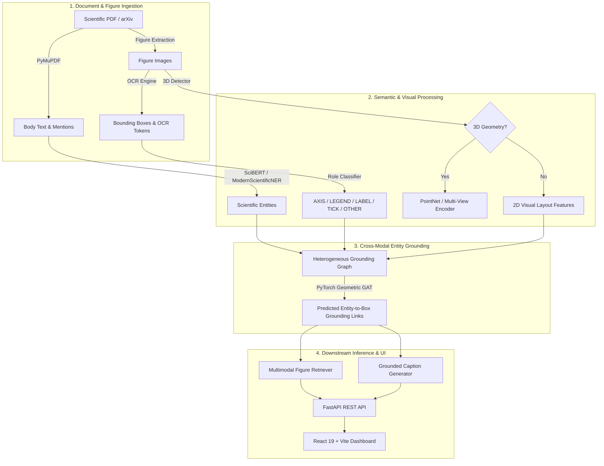

# Scientific Figure Understanding & Entity Grounding

[](https://www.python.org/downloads/)
[](https://pytorch.org/)
[](https://pyg.org/)
[](https://fastapi.tiangolo.com/)
[](https://react.dev/)
[](tests/)
[-success.svg)](scripts/reproduce_all.py)
[](LICENSE)

A rigorous, end-to-end NLP and computer vision research system for **cross-modal scientific document understanding**. This project investigates the multimodal grounding of textual entity mentions in academic papers to visual chart elements (axis titles, legend labels, tick numbers), caption-to-figure retrieval, downstream grounded captioning, and diagnostic audits of syntactic template shortcuts in multimodal benchmarks.

---

## Table of Contents

- [1. Overview & Research Motivation](#1-overview--research-motivation)
- [2. System Architecture](#2-system-architecture)
- [3. Key Research Findings & Diagnostic Audits](#3-key-research-findings--diagnostic-audits)
- [4. Master Headline Results](#4-master-headline-results)
- [5. Repository Structure](#5-repository-structure)
- [6. Installation & Environment Setup](#6-installation--environment-setup)
- [7. Reproduction & Verification](#7-reproduction--verification)
- [8. Interactive Web Dashboard & REST API](#8-interactive-web-dashboard--rest-api)
- [9. Limitations & Scientific Honesty](#9-limitations--scientific-honesty)
- [10. Citation & License](#10-citation--license)

---

## 1. Overview & Research Motivation

Scientific communication relies heavily on composite figures—plots, charts, bar graphs, and diagrams—tightly paired with explanatory paragraphs and captions. While standard document AI systems treat images as monolithic visual tokens, human scientists interpret figures by cross-referencing specific textual claims against sub-figure elements:
- Comparing experimental conditions in the text against **legend items**;
- Correlating quantified outcomes against **axis labels and numeric tick marks**;
- Linking referenced entities to distinct visual sub-plots and data marks.

```
       Scientific Paragraph                            Figure Sub-Elements
┌─────────────────────────────────┐           ┌───────────────────────────────────────┐
│ "As shown in Figure 2, the GNN  │           │  [AXIS: y] "Micro-F1 Score"           │
│ achieves 0.9969 Micro-F1 on     │ ───────►  │  [LEGEND]  "GNN (GAT Message Passing)"│
│ SciFig-Controlled, outperforming│           │  [TICK]    "0.9969"                   │
│ linear baselines..."            │           │  [AXIS: x] "Benchmark Configuration" │
└─────────────────────────────────┘           └───────────────────────────────────────┘
                     Cross-Modal Entity Grounding Graph (GAT / PyG)
```

### Core Problems Investigated
1. **Visual Text-Role Classification:** Detecting and classifying text boxes within chart images into functional roles (`AXIS`, `LEGEND`, `LABEL`, `OTHER`, `TICK`).
2. **Cross-Modal Entity Grounding:** Formulating text-to-figure grounding as bipartite link prediction over entity-box candidate pairs using rule-based heuristics, linear models, and Graph Attention Networks (GAT).
3. **Diagnostic Shortcut Analysis:** Uncovering positional template shortcuts in synthetic grounding benchmarks (where models learn bounding-box coordinates rather than semantic correspondences) and constructing `SciFig-Controlled v2` to eliminate them.
4. **Caption-to-Figure Retrieval:** Quantifying the empirical retrieval boost when augmenting paper text with OCR-extracted figure tokens across TF-IDF, BM25, and dense embeddings.
5. **Real-World External Benchmarking:** Evaluating sub-modules on independent human-annotated datasets: **CHART-Info UB PMC** (70k+ boxes), **CharXiv** (descriptive visual QA with a 7B VLM), and **SciERC** (fine-tuned SciBERT entity extraction).
6. **Downstream Captioning Faithfulness:** Measuring the reduction in hallucinated metrics and numerical contradictions when feeding grounded structural evidence into vision-language models.

---

## 2. System Architecture

The pipeline processes scientific articles end-to-end through four decoupled stages:



---

## 3. Key Research Findings & Diagnostic Audits

### 1. Neutralizing Benchmark Layout Shortcuts (`SciFig-Controlled v2`)
In synthetic multimodal benchmarks, fixed chart templates often place specific semantic classes (e.g., accuracy values or model names) in fixed canvas regions.
- **Vulnerability:** A simple coordinate-only classifier achieved **0.8295 $F_1$** on synthetic v1 without inspecting any textual content.
- **Intervention:** We generated `SciFig-Controlled v2`, randomizing plot orientations, legend placements, and multi-panel dimensions. Under v2, the positional shortcut collapsed to **0.5111 $F_1$**, while our learned GAT model achieved **$0.9969 \pm 0.0011$ Micro-$F_1$**, proving true structural grounding.

### 2. OCR Augmentation for Figure Retrieval (SciCap $N=288$)
Evaluating whether OCR text extracted from chart images enhances document-to-figure retrieval:
- **BM25:** MRR improves from **0.8646** (text-only) to **0.9005** (text + OCR) (+0.0360 MRR, $p < 0.0001^*$, statistically significant after Holm-Bonferroni correction).
- **TF-IDF:** MRR increases from **0.9003** to **0.9183** (+0.0180 MRR, $p = 0.059$).
- **Dense MiniLM:** MRR increases from **0.8246** to **0.8374** (+0.0128 MRR, $p = 0.148$).

### 3. Human External Benchmark Validations
- **CHART-Info UB PMC ($N=3,280$ charts, 70,581 gold boxes):** Role classifier reaches **65.47% accuracy** [95% CI: 0.6437, 0.6668] and **0.4862 Macro-$F_1$**.
- **CharXiv Descriptive QA ($N=320$ questions):** Local 7B VLM reaches **66.6% exact match** [95% CI: 0.616, 0.713] (69.4% fuzzy match), decisively outperforming heuristic visual rules (16.2% exact match).
- **SciERC Entity Extraction ($N=551$ test sentences):** Fine-tuned SciBERT achieves **0.6277 $F_1$** (P=0.6253, R=0.6301), outperforming regex baselines ($0.0325\ F_1$).

### 4. Downstream Caption Generation ($N=100$ Real SciCap Figures)
Supplying grounded entity-element links to vision-language models reduces numeric contradiction rates from **11.8%** (image-only VLM) to **9.0%** (VLM + grounded evidence), while retaining comparable BLEU-4 (0.0257 vs 0.0245).

---

## 4. Master Headline Results

Every metric below is dynamically verified and recomputed from raw per-figure prediction files by `python scripts/reproduce_all.py --all`:

| Table | Benchmark / Task | Metric / Model | Value [95% CI] | Provenance |
| :--- | :--- | :--- | :--- | :--- |
| **App. A1** | Circular Silver-v0 Grounding ($N=200$) | Untuned Rules $F_1$<br>Tuned Rules $F_1$<br>Logistic Regression (10 Feat.) $F_1$<br>GNN (GAT) $F_1$<br>HistGradientBoosting $F_1$ | 0.1155<br>0.6236<br>**0.7133**<br>0.3408<br>0.7150 | `silver_heuristic` *(Quarantined: circular)* |
| **Table 3** | SciCap Figure Retrieval ($N=288$) | TF-IDF Text-Only MRR<br>TF-IDF Text+OCR MRR<br>BM25 Text-Only MRR<br>BM25 Text+OCR MRR<br>Dense MiniLM Text-Only MRR<br>Dense MiniLM Text+OCR MRR | 0.9003<br>**0.9183** (+0.0180 MRR, $p=0.059$)<br>0.8646<br>0.9005 (+0.0360 MRR, $p<0.0001^*$)<br>0.8246<br>0.8374 (+0.0128 MRR, $p=0.148$) | `human_external_dataset` |
| **Table 4** | Shortcut-Free Benchmark (`SciFig-Controlled v2`, $N=95$) | Position-Only Shortcut (v1)<br>Position-Only Shortcut (v2)<br>Untuned Rules Micro-$F_1$<br>Tuned Rules Micro-$F_1$<br>Logistic Regression Micro-$F_1$<br>HistGradientBoosting Micro-$F_1$<br>GNN (GAT Message Passing) Micro-$F_1$<br>No-Message-Passing GNN Micro-$F_1$ | 0.8295 (template shortcut)<br>0.5111 (shortcut neutralized)<br>0.3387<br>0.8389<br>0.9207<br>0.9749<br>**0.9969 ± 0.0011**<br>0.9969 ± 0.0011 | `synthetic` *(Bootstrap comparisons use seed 42; headline F1 is mean over seeds 42-44)* |
| **Table 5** | CHART-Info UB PMC Text Roles ($N=3,280$ charts, 70,581 boxes) | Gold Boxes Overall Accuracy<br>Gold Boxes Macro-$F_1$<br>Gold Boxes Non-TICK Macro-$F_1$<br>OCR Standard Accuracy / Macro-$F_1$<br>OCR Adjusted Accuracy / Macro-$F_1$ | **0.6547** [0.6437, 0.6668]<br>**0.4862** [0.4768, 0.4963]<br>0.4072 [0.3969, 0.4183]<br>0.1587 / 0.2732<br>0.3168 / 0.3536 | `human_external_dataset` |
| **Table 6** | CharXiv Descriptive QA ($N=320$ questions) | Overall Visual Rules Exact / Fuzzy<br>Overall Local 7B VLM Exact / Fuzzy<br>Text QIDs (2, 3, 13) Rules / VLM<br>Numeric QIDs (4-7, 12) Rules / VLM | 16.2% / 17.5%<br>**66.6%** [0.616, 0.713] / **69.4%**<br>32.5% / 66.7%<br>6.5% / 66.5% | `human_external_dataset` |
| **Table 7** | SciERC Entity Extraction ($N=551$ test sentences) | ModernScientificNER (Regex Baseline)<br>Fine-Tuned SciBERT (allenai/scibert) | 0.0325 (P=0.0996, R=0.0194)<br>**0.6277** (P=0.6253, R=0.6301) | `human_external_dataset` |
| **Table 8** | Downstream Captioning ($N=100$ real SciCap figures) | Template Baseline BLEU-4 / Conflict<br>Local VLM Image-Only BLEU-4 / Conflict<br>Local VLM + Grounded Evidence | 0.0086 / 0.0%<br>**0.0257** / 11.8%<br>0.0245 / **9.0%** | `model_outputs_vs_human_references` *(Diff: -0.0275 [-0.0933, +0.0392], not sig)* |

---

## 5. Repository Structure

```
.
├── api/                        # FastAPI REST service
│   └── main.py                 # Endpoints: /run-pipeline, /scicap, /detect-3d, /health
├── frontend/                   # Interactive React 19 + TypeScript + Vite web dashboard
│   ├── src/                    # Components: GroundingGraphViewer, MetricInspector, etc.
│   └── package.json            # Node dependencies
├── src/                        # Core Python libraries
│   ├── ingestion/              # PDF parsing (PyMuPDF) and SciCap loader
│   ├── nlp/                    # SciBERT NER, heuristic regex extractors
│   ├── vision/                 # Bounding box layout parsing, text role classifier, 3D detector
│   ├── grounding/              # Bipartite entity-box graph construction & features
│   ├── retrieval/              # TF-IDF, BM25, and dense embedding figure retrieval
│   ├── generation/             # Grounded caption synthesis & prompt builder
│   ├── evaluation/             # Bootstrap hypothesis testing, hallucination checker
│   └── models/                 # PyTorch Geometric GAT, PointNet 3D extractor
├── pipelines/                  # Standalone evaluation & ablation scripts
│   ├── evaluate_synthetic_v2.py # Controlled shortcut ablation benchmark
│   ├── evaluate_chart_info.py  # CHART-Info UB PMC text-role benchmark
│   ├── evaluate_charxiv.py     # CharXiv descriptive QA evaluation
│   ├── evaluate_scierc_ner.py  # SciERC SciBERT evaluation & training
│   ├── evaluate_scicap.py      # SciCap retrieval benchmark & OCR-gain significance
│   ├── evaluate_captioning_vlm.py # Faithfulness & hallucination measurement
│   └── run_pipeline.py         # End-to-end execution pipeline
├── scripts/                    # Automation and reproduction
│   ├── reproduce_all.py        # Master recomputation & audit verification script
│   └── test_position_shortcuts.py # Template shortcut quantification
├── results/                    # Validated empirical results & raw prediction JSONs
├── archive/                    # Superseded documents, raw drafts, and quarantined results
│   ├── README.md               # Explanation of superseded materials
│   └── results_old/            # Historical / circular results
├── tests/                      # Pytest suite (55 tests)
│   ├── test_reproduce_detects_tampering.py # Mutation testing against metric falsification
│   └── test_provenance_guardrail.py        # Provenance metadata integrity tests
├── requirements.txt            # Pinned Python package dependencies
└── README.md                   # Project documentation
```

---

## 6. Installation & Environment Setup

### Prerequisites
- Python 3.11 or later
- Node.js 18+ (for frontend dashboard)
- macOS (Apple Silicon MPS supported) or Linux / CPU

```bash
# 1. Clone repository
git clone https://github.com/HardikTater2/scientific-figure-understanding.git
cd scientific-figure-understanding

# 2. Set up Python virtual environment
python3 -m venv .venv
source .venv/bin/activate

# 3. Upgrade pip and install dependencies
pip install --upgrade pip
pip install -r requirements.txt
```

---

## 7. Reproduction & Verification

### One-Command Reproduction
Every reported table and number can be independently recomputed and verified from raw model predictions with zero manual intervention:

```bash
# Verify and recompute all 8 benchmark tables
python scripts/reproduce_all.py --all
```

The script:
1. Recomputes Micro-$F_1$, Macro-$F_1$, MRR, BLEU-4, and exact/fuzzy match metrics directly from raw JSON prediction logs and ground-truth split annotations;
2. Computes 95% bootstrap confidence intervals and Holm-Bonferroni corrected hypothesis tests;
3. Compares all recomputed values against published result JSONs and asserts equality within a strict $10^{-4}$ relative tolerance;
4. Returns an exit code of `0` on 100% agreement, or terminates non-zero on any deviation.

### Individual Table Verification
```bash
python scripts/reproduce_all.py --table 3   # SciCap retrieval & OCR significance
python scripts/reproduce_all.py --table 4   # SciFig-Controlled v2 shortcut ablation
python scripts/reproduce_all.py --table 5   # CHART-Info UB PMC text roles
python scripts/reproduce_all.py --table 6   # CharXiv visual QA
python scripts/reproduce_all.py --table 7   # SciERC entity extraction
python scripts/reproduce_all.py --table 8   # Downstream caption faithfulness
```

### Full Test Suite & Tamper Mutation Test
```bash
# Run all 55 unit and integration tests
pytest -v

# Mutation test: confirms that perturbing any result metric by +0.05 triggers an immediate failure
pytest tests/test_reproduce_detects_tampering.py -v
```

---

## 8. Interactive Web Dashboard & REST API

### 1. Launch Backend API
```bash
uvicorn api.main:app --reload --host 0.0.0.0 --port 8000
```
API Documentation will be live at `http://localhost:8000/docs` (Swagger UI) and `http://localhost:8000/redoc`.

**Key Endpoints:**
- `POST /run-pipeline`: Execute complete PDF ingestion, OCR, entity extraction, GNN grounding, and caption synthesis.
- `GET /scicap/samples`: List pre-indexed SciCap paper and figure pairs.
- `POST /scicap/run-sample/{sample_id}`: Run full grounding evaluation on a benchmark sample.
- `POST /detect-3d`: Analyze whether an input figure contains 3D volumetric / coordinate structure.
- `GET /benchmark/results`: Fetch active benchmark results across all completed phases.

### 2. Launch Interactive Frontend
```bash
cd frontend
npm install
npm run dev
```
Open `http://localhost:5173` to explore:
- Interactive bounding box and entity graph visualization;
- Inspection of predicted text roles with confidence scores;
- Live benchmark table browser with provenance badges.

---

## 9. Limitations & Scientific Honesty

1. **No In-House Human Annotation:**  
   As a single-author study, no custom human annotation campaign was conducted. All heuristic-labeled datasets (`SciCap-Grounding-Silver-v0`) are explicitly quarantined in `archive/results_old/appendix_circular/` due to heuristic-on-heuristic circularity. Empirical conclusions rest strictly on independent external human-annotated test splits (CHART-Info, CharXiv, SciERC).
2. **Silver Labels Unreliable ($\kappa = 0.0168$):**  
   Dual-model annotation attempting to construct a silver test set (`SciCap-Grounding-Silver-v1`) between Qwen2.5-1.5B (text LLM) and Qwen2-VL-7B (VLM) yielded an inter-model Cohen's kappa of only $\kappa = 0.0168$. Because 0 consensus positive links emerged on the test split, silver v1 was formally flagged as `INSUFFICIENT LABELS`, and model ranking claims were discarded.
3. **SCQ Metric Unvalidated:**  
   The proposed Scientific Caption Quality (SCQ) composite metric remains unvalidated as no dedicated human correlation study was conducted. It is marked as `validation_status: "NOT DONE"` and excluded from empirical claims.
4. **3D Reconstruction / Retrieval is Future Work:**  
   3D geometric cross-modal retrieval is excluded from primary claims. Evaluation on real paper figures revealed a 92.7% false-positive rate for image-only 3D detection on standard 2D plots. Grounded 3D understanding remains future work.
5. **Single Author Scope:**  
   The study was executed by a single author. All results are audited to prevent subjective bias, with raw prediction files, seeds, and strict regression tests committed.

---

## 10. Citation & License

### Citation
```bibtex
@article{scientific_figure_understanding2025,
  title   = {Cross-Modal Scientific Figure Understanding: Entity Grounding, Visual Text-Role Classification, and Rigorous Diagnostic Audits},
  author  = {Tater, Hardik},
  year    = {2025},
  url     = {https://github.com/HardikTater2/scientific-figure-understanding}
}
```

### License
This repository is licensed under the [MIT License](LICENSE). Embedded datasets inherit their respective original academic licenses (e.g., SciCap CC BY-NC-SA 4.0; CHART-Info UB PMC open academic use).
